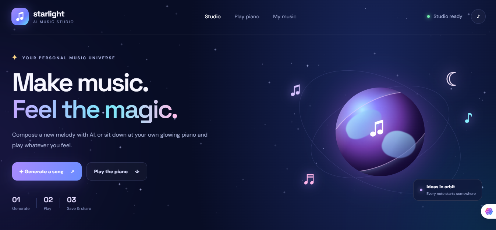
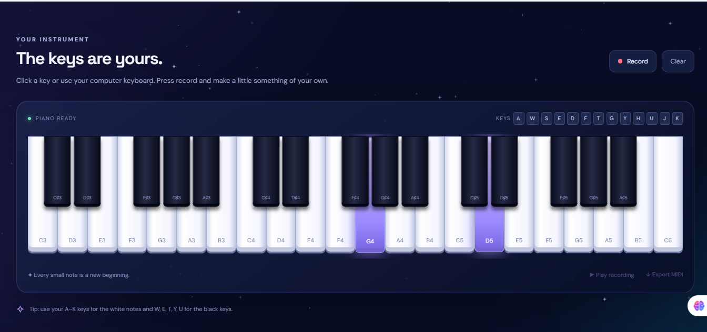
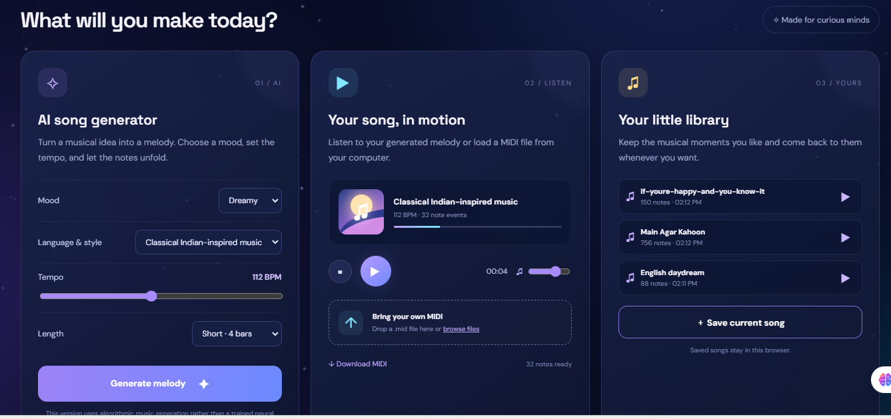

# 🎵 Starlight AI Music Studio

**Create, play, and export music with an interactive piano and AI-inspired music studio.**

Starlight AI Music Studio is a web-based music application built with Python, Flask, JavaScript, HTML, and CSS. It allows users to generate instrumental melodies, play piano notes, import MIDI files, and export their musical creations.

The project also supports Hindi and Urdu-inspired music generation, including Bollywood-style melodies, Pakistani drama OSTs, ghazals, qawwali-inspired music, and romantic or sad melodies.

## ✨ Features

- 🎹 **Interactive Piano:** Play musical notes directly from the browser.
- 🎼 **Music Generation:** Generate instrumental melodies based on selected styles and musical settings.
- 🌍 **Multiple Music Styles:** Create English, Hindi Bollywood, Urdu, Pakistani drama OST, ghazal, qawwali-inspired, romantic, and sad melodies.
- 🎹 **MIDI Import:** Load and play supported MIDI files.
- 💾 **MIDI Export:** Download generated melodies as MIDI files.
- 🎧 **Music Playback:** Listen to your generated music in the application.
- 🎙️ **Recording and Playback:** Record piano performances and play them back, where supported.
- ⭐ **Animated Interface:** Enjoy glowing stars, floating musical notes, and a visually engaging music studio.
- 🖥️ **Local Application:** Run the application on your own computer.

## 📸 Application Screenshots

### 🏠 Home Page


### 🎹 Interactive Piano


### 🎵 AI Music Generator



## 🛠️ Technologies Used

- Python
- Flask
- JavaScript
- HTML5
- CSS3
- MIDI processing and playback libraries

## 🎶 Supported Music Styles

| Style | Description |
|---|---|
| English | General instrumental melodies |
| Hindi Bollywood | Bollywood-inspired melodic patterns |
| Urdu | Urdu music-inspired instrumental melodies |
| Pakistani Drama OST | Emotional and cinematic melodies |
| Ghazal | Soft, expressive melodic patterns |
| Qawwali-inspired | Energetic, repetitive melodic patterns |
| Romantic | Gentle and expressive melodies |
| Sad | Slow and emotional melodies |
| Indian Classical-inspired | Melodies using selected Indian classical-inspired scales |

**Note:** These styles are musical inspirations. Generated MIDI files contain musical notes rather than actual Hindi or Urdu lyrics or sung vocals.

## 🚀 Getting Started

### 1. Download the Project

Clone the repository:

```bash
git clone YOUR_GITHUB_REPOSITORY_URL
```

Alternatively, download the repository as a ZIP file and extract it.

### 2. Open the Project Folder

```bash
cd starlight-ai-music-studio
```

Use your actual project folder name if it differs.

### 3. Create a Virtual Environment

```bash
python -m venv .venv
```

### 4. Activate the Environment

**Windows Command Prompt:**

```bash
.venv\Scripts\activate
```

**Windows PowerShell:**

```powershell
.\.venv\Scripts\Activate.ps1
```

### 5. Install Dependencies

```bash
pip install -r requirements.txt
```

### 6. Run the Application

```bash
python app.py
```

Open your browser and visit:

```text
http://127.0.0.1:5000
```

## 🎹 How to Use

1. Open Starlight AI Music Studio in your browser.
2. Select a music style or language.
3. Enter a prompt describing the melody you want.
4. Adjust the available musical settings.
5. Generate your instrumental melody.
6. Play the music and experiment with the piano.
7. Import a MIDI file if you want to listen to existing music.
8. Export your generated melody as a MIDI file.

## 💡 Example Prompts

Try these prompts in the music generator:

- Create a slow and emotional Urdu-inspired melody.
- Generate a romantic Bollywood-style instrumental.
- Create a Pakistani drama OST with a cinematic mood.
- Generate a soft ghazal-inspired melody.
- Create an energetic qawwali-inspired instrumental.
- Generate a peaceful melody inspired by Indian classical music.
- Create a happy English pop melody.

The results depend on the music-generation algorithm and the features implemented in the application.

## 🧠 How It Works

The application uses a Flask backend to serve the web interface and JavaScript to handle browser interactions.

The music-generation component converts musical settings and supported prompts into note sequences. These sequences can be played in the browser and exported as MIDI files.

MIDI represents musical events such as pitch, duration, and timing. It does not contain a recording of a singer or automatically include song lyrics.

**AI implementation note:** If the current version uses rule-based or algorithmic melody generation, it should be described as algorithmic music generation rather than a trained deep-learning model. A trained neural music-generation model can be integrated as a future improvement.

## 🔌 Offline Support

The application can run locally on your computer. However, offline operation depends on whether all required JavaScript libraries and other assets are stored locally. Internet access may still be required if the project loads any dependencies from external CDNs.

## 🔮 Future Improvements

- Integrate a trained LSTM or Transformer music-generation model.
- Improve Hindi and Urdu-inspired melodic patterns.
- Add more musical scales and rhythmic patterns.
- Add separate melody, bass, and accompaniment tracks.
- Improve MIDI instrument selection.
- Add audio export, such as WAV or MP3.
- Integrate vocal synthesis and lyric generation as separate features.
- Add more advanced music-generation controls.

## 🎯 Project Goal

The goal of Starlight AI Music Studio is to provide an accessible environment where users can explore music creation, experiment with melodies, play piano notes, and generate downloadable MIDI files through an interactive web interface.


